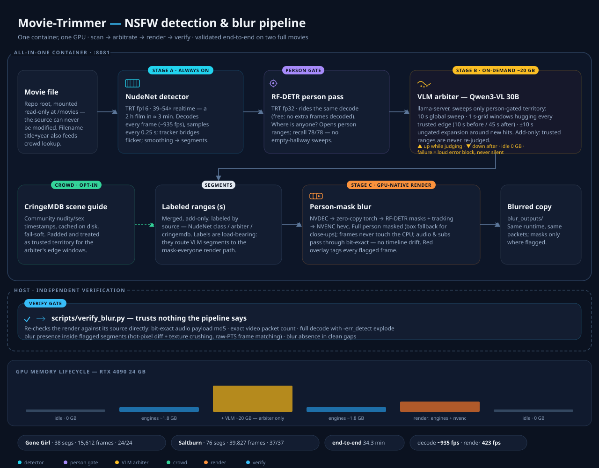

# Movie-Trimmer

GPU-native NSFW auto-detection and masking for movies: a FastAPI service that
scans a film for explicit content, then renders a copy in which every flagged
moment is masked with **solid-black person-shaped masks** — no cuts, no
timeline drift, audio and subtitles bit-exact. It began as a movie trimmer /
subtitle merger (`main.py`, still here) and grew the scanner (`scanner/`) into
the main event.

The whole pipeline — person gate, VLM arbiter, community timestamps, GPU mask
render — runs in **one container** on one GPU. There is no image detector:
discovery is VLM-first (Qwen3-VL judging a sparse, person-gated plan),
validated across three full movies (see `scans/VLM_RUNS.md`).



Design principle throughout: **add-only**. Crowd and VLM findings can each
only add territory; nothing can shrink or remove a flagged range, so
re-scanning can never reduce coverage.

## Quick start

Prereqs: an NVIDIA GPU (24 GB for the full pipeline with the VLM arbiter;
renders without the arbiter fit in ~4 GB), the NVIDIA container toolkit, and
ffmpeg/ffprobe on the host (verification only).

```bash
# put the movie anywhere in the repo (mounted read-only at /movies)
mv My.Movie.2023.1080p.mkv .

# run the published appliance (pulls from GHCR; --build rebuilds locally)
python3 run.py --wait 120          # healthy → http://localhost:8081/health
```

`run.py` runs a `--rm` container under the definite name `movie-trimmer`,
mirroring `docker-compose.yml` (engine cache, repo read-only at `/movies`,
mask outputs). It also removes any foreign container squatting port 8081
(e.g. an old compose stack). `docker stop movie-trimmer` tears it down.

## Scanning

```bash
# full scan: person-gated VLM arbiter + CringeMDB crowd timestamps;
# the IMDb parents-guide context is on by default (seeded cache,
# fail-soft) — omit with -F guide=false
curl -X POST http://localhost:8081/scan \
  -F video_path=/movies/film.mkv -F arbiter=true -F crowd=true

# explicit guide request (same as the default; context loads from
# scans/guide_cache when seeded for this film)
curl -X POST http://localhost:8081/scan \
  -F video_path=/movies/film.mkv -F arbiter=true -F crowd=true -F guide=true

curl http://localhost:8081/scan/{scan_id}    # 202-async → status + segments
```

Each request returns immediately; poll `GET /scan/{scan_id}` until
`completed`. The result JSON carries the segment list (seconds, `labels`
naming the source: `arbiter` / `cringemdb:<category>`), per-frame arbiter
verdicts, crowd bookkeeping, per-stage timings, and the person-gate ranges.

**How the sources combine:**

- **Person gate (RF-DETR Seg Medium, TRT fp32)** — presence pass riding the
  scan's decode at zero extra decode cost (0.5 s resolution, own CUDA
  stream); computes ranges where a person is on screen. The arbiter only
  spends frames there: an empty hallway cannot host explicit content. Gate
  recall is audited, not assumed (78/78 explicit hits covered on the
  calibration movie). Fail-open: a gate failure means a full sweep — VLM
  time, never coverage.
- **VLM arbiter (Qwen3-VL-30B-A3B via llama-server)** — judges sparse,
  curated frames (~2% of the movie): a person-gated global sweep (every
  5 s), dense 1 s-spaced windows hugging every trusted segment's edges
  (10 s before / 45 s after — scene spill lives there), and a ±10 s
  expansion pass re-measuring each sweep hit's neighborhood at 1 s density.
  Explicit findings become new segments; existing ones are never re-judged.
  The server is **on-demand**: spawned when arbiter work starts (~20 GB,
  seconds warm / minutes cold), stopped when it ends — idle VRAM use is
  zero. Bring-up failure is loud (error block in the result JSON), never
  silent.
- **Crowd (CringeMDB scene guides)** — community timestamp ranges for
  nudity/sex categories, cached on disk, fail-soft (site down → scan
  proceeds). Entries are padded and treated as trusted territory.

## Masking

```bash
# from a completed scan (same container run); output_name names the
# final file, and mask-region chapters are baked automatically
curl -X POST http://localhost:8081/mask \
  -F video_path=/movies/film.mkv -F scan_id={scan_id} \
  -F output_name=Film.2023.masked.mp4

# from explicit segments — send FULL segment dicts, not bare pairs:
# labels carry the overlay text and the crowd category, and gate the
# full-frame failsafe when the segmenter finds nobody
curl -X POST http://localhost:8081/mask \
  -F video_path=/movies/film.mkv \
  -F 'segments=[{"start": 42.0, "end": 58.0, "labels": {"arbiter": 1}}]'

# fast preview of one window (chapters skipped: offset timeline)
curl -X POST http://localhost:8081/mask -F video_path=/movies/film.mkv \
  -F 'segments=[[844.8, 859.5]]' -F window_start=840 -F window_end=865 \
  -F bake_chapters=false

curl http://localhost:8081/mask/{mask_id}    # → output path in mask_outputs/
```

Every person the segmenter finds inside a flagged range is masked whole
(solid black, temporally smoothed so silhouettes don't flicker; a centered
rectangle catches extreme close-ups where nobody is detectable). Masks are
segmented per frame at the source's native fps (`MASK_KEYFRAME_FPS=0`; a
fixed economy rate can be set). Full renders are one continuous GPU-native
pass — NVDEC → zero-copy torch → NVENC (hevc, p5) — with the analysis
overlapped on the encode: each segment's masks stream to the render head
the moment they are final. Frames never touch the CPU; audio and subtitles
pass through bit-exact — frame and packet counts match the source exactly.
Every flagged frame also carries a red overlay
(`VULGARITY DETECTED / <conf>% <label>`); `MASK_OVERLAY=0` disables it.

## Chapters

Every full render ends with mask-region chapters baked in (stream copy,
no re-encode): each segment becomes a named chapter — `▶ MASK · VLM 94%` —
and gap fillers bracket every mask with seek-bar ticks in mpv. Names flash
on seek and drive chapter navigation (`PgUp`/`PgDn`). A completed render
can be (re-)chaptered standalone:

```bash
curl -X POST http://localhost:8081/chapters \
  -F output_path=/mask_outputs/OUT.mp4 \
  -F 'segments=[{"start": 42.0, "end": 58.0, "labels": {"arbiter": 1}}]'
```

## Verification

`POST /verify` (in-container, CPU) re-checks a render against its source
without trusting the pipeline: container/duration sanity, full decode with
`-err_detect explode`, exact video packet count, audio payload md5
(bit-exact), mask **presence** inside flagged segments (hot-pixel diff +
blackout + texture crushing against the nearest source frames, matched by
raw PTS), and mask **absence** in clean gaps. Spots are auto-derived from
segment provenance (crowd / arbiter + evenly-spread clean times) unless
given explicitly:

```bash
curl -X POST http://localhost:8081/verify \
  -F video_path=/movies/film.mkv -F output_path=/mask_outputs/OUT.mp4 \
  -F 'segments=[...]'            # or -F mask_id={id} alone
curl http://localhost:8081/verify/{verify_id}   # → checks[], all_pass
```

## Validated end-to-end

Three full movies, no manual intervention between phases, judged by the
gate (detector-free pipeline throughout; records in `scans/VLM_RUNS.md`):

| | Gone Girl (2014) | Saltburn (2023) | Wolf of Wall Street (2013) |
|---|---|---|---|
| segments (arbiter + crowd) | 21 (17 + 4) | 33 (22 + 11) | 31 (22 + 9) |
| flagged time | 709 s (7.9%) | 1,686 s (21.3%) | 1,780 s |
| frames masked | 16,997 | 40,497 | 42,675 |
| verify gate | 11/11 PASS | 11/11 PASS | 10/10 PASS |

Throughput (GG, 2.5 h film): the 2026-11 throughput pass took scans
1,274 → 796 s (**1.60×**, arbiter frame extraction fixed) and renders
~700 → 586 s (**−16%**, analysis overlapped on the encode); scan + render
**−30%**. Post-NudeNet-strip confirmation on the same film: scan 821 s,
render 588 s, verify 11/11, mask pixel counts identical to baseline
(`scans/THROUGHPUT.md`). Remaining floors: VLM judging (~0.3 s/frame
across 4 slots) and NVENC encode (~450 fps) — the levers over them are
quality decisions, not engineering ones.

Source codecs covered: hevc 10-bit 16:9 and h264 8-bit 4:3.

## API summary

| endpoint | purpose |
|---|---|
| `POST /scan` | async scan (form: `video_path`, `arbiter`, `arbiter_mode=apply\|verify`, `arbiter_model`, `crowd` + `crowd_title`/`crowd_year`, `guide`, `sample_fps`, `smoothing`) |
| `GET /scan/{id}` | status + result JSON |
| `POST /mask` | async render (form: `video_path`, `scan_id` or `segments`, `cq`, `window_start/end`, `output_name`, `bake_chapters`) — solid-black person masks + chapters |
| `GET /mask/{id}` | status → `output` path, render stats, chapters |
| `POST /verify` | async render gate (form: `video_path`+`output_path`, or `mask_id`; optional `masked_i[]`, `clean_t[]`) |
| `GET /verify/{id}` | status → `checks[]`, `all_pass` |
| `POST /chapters` | bake mask chapters into a render in place (`output_path` or `mask_id`, + `segments`/`scan_id`) |
| `GET /scans`, `GET /masks`, `GET /verifies` | lists |
| `GET /health` | GPU/TRT state, model presence, on-demand VLM server state |

## Configuration

Key env knobs (all have sane defaults; see `scanner/config.py`):

| env | default | meaning |
|---|---|---|
| `PERSON_GATE_ENABLED` | 1 | RF-DETR gate for the arbiter sweep |
| `ARBITER_SWEEP_EVERY_S` | 5 | global sweep spacing (person-gated) |
| `ARBITER_MAX_FRAMES` | 0 | arbiter frame cap (0 = uncapped) |
| `ARBITER_SWEEP_PAD_S` | 10 | pad around explicit sweep hits |
| `ARBITER_EXPAND_MAX_FRAMES` | 192 | expansion budget around new hits |
| `ARBITER_HTTP_CONCURRENCY` | 4 | concurrent VLM requests (match llama-server slots) |
| `ARBITER_SELECT_MIN` | 400 | ≥ this many frames → one select-pass extraction, else per-seek |
| `CROWD_CATEGORIES` | nudity,sex | in-scope crowd categories |
| `CROWD_PAD_S` | 1.5 | padding around crowd ranges |
| `GUIDE_CACHE_DIR` | scans/guide_cache | parents-guide context cache (guide on by default; IMDb blocks live fetches, so guides are seeded here browser-assisted) |
| `VLM_START_TIMEOUT_S` | 900 | llama-server bring-up budget |
| `MASK_KEYFRAME_FPS` | 0 | mask analysis rate; 0 = every frame at native fps (capped 30) |
| `MASK_OVERLAP` | 1 | overlap mask analysis on the encode (full renders) |
| `MASK_OVERLAY` | 1 | red warning overlay on flagged frames |
| `DEFAULT_ARBITER_MODE` | apply | `verify` reports verdicts, changes nothing |

## Repo layout

```
scanner/          the NSFW pipeline (decode, person gate, arbiter,
                  crowd, mask, verify, API) — packaged into the images
scripts/          segments_table.py, person_probe.py, eval_gt.py, eval/
                  (prompt-replay harness — dev-time, host-side)
docker/           entrypoints for the scanner / all-in-one images
tests/            110 CPU-only tests: pytest tests/ -q
run.py            run the appliance (docker run --rm, port hygiene)
build.py          build + push all images
docker-compose.yml  alternative launch (same container, restart: unless-stopped)
NSFW_SCANNER_DESIGN.md  the full design doc — research, calibration,
                  architecture and every incident (§1–13)
ANALYSIS.md       code review of the original trimmer
```

Models are baked into versioned weight images (nothing downloads at run
time; `HF_HUB_OFFLINE=1` makes accidental hub access a hard error):

```
ghcr.io/darkstar1997/movietrimmer-rfdetr-seg-weights:v1   RF-DETR Seg Medium
ghcr.io/darkstar1997/movie-trimmer-vlm-qwen3vl-30b-a3b:v1 Qwen3-VL-30B GGUF
ghcr.io/darkstar1997/movie-trimmer-scanner:v1             scanner (stages A–C)
ghcr.io/darkstar1997/movie-trimmer:v1                     all-in-one appliance
```

## Development

```bash
python3 build.py            # build scanner + all-inone
python3 build.py --push     # build + push to GHCR
.venv/bin/python -m pytest tests/ -q    # host, CPU-only, no torch needed
```

TRT engines are cached in `trt_cache/`, keyed by a fingerprint of the ONNX
content and build recipe (fp16/fp32) — first use builds (~1–3 min per model),
after which scans start cold in seconds. Scan/mask artifacts land in
`scans/` and `mask_outputs/` (gitignored).

## The original trimmer

`main.py` (port 8000) is the pre-scanner core: cut-list trimming with
subtitle re-merging, frame-accurate, audio passthrough. A scan's segments
feed it directly. See `ANALYSIS.md` for its code review.
